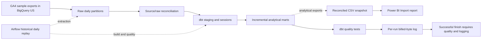
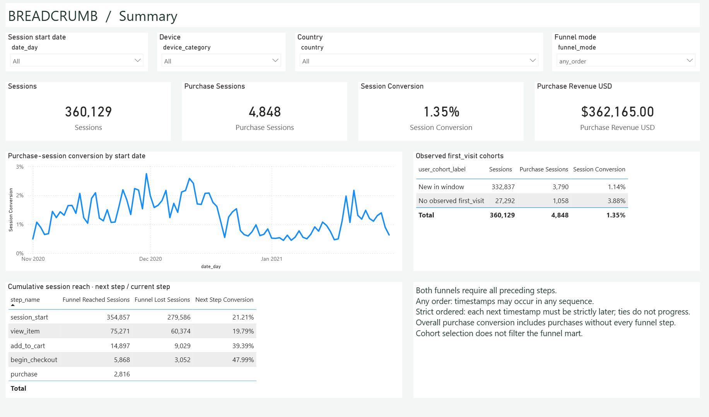

# Breadcrumb: GA4 Checkout Funnel & Conversion Analytics

I built Breadcrumb to answer a practical ecommerce question: where do buyers leave
checkout, and what might improving the weakest step be worth? I used Google's
public, obfuscated GA4 sample for a hypothetical Head of Ecommerce, covering
November 1, 2020 through January 31, 2021.

I combined a BigQuery/dbt analytical model, an Airflow historical replay pipeline,
a four-page Power BI CSV Import report, and an evidence-backed decision memo.
My stack is **Python 3.12 + uv, BigQuery, dbt Core, Airflow in Docker/Astro,
Power BI, GitHub Actions, pytest, ruff, and SQLFluff**.

## What I found

| Measured result | Value | Key in [metrics.json](reports/metrics.json) |
|---|---:|---|
| Export events | 4,295,584 | `profiling_summary.events` |
| Sessions, keyed by user and session ID | 360,129 | `analysis.all_sessions` |
| Purchase sessions | 4,848 | `analysis.purchase_sessions` |
| Purchase-event USD revenue | 362,165 | `profiling_summary.purchase_revenue_usd` |
| Any-order complete funnel purchases | 2,816 | `analysis.global_funnel[4].any_order_sessions` |
| Strict ordered complete funnel purchases | 2,735 | `analysis.global_funnel[4].strict_ordered_sessions` |
| Purchase-event minus item USD revenue | 55 | `profiling_summary.event_minus_item_revenue_usd` |

I identified `session_start → view_item` as the largest **modeled** opportunity:
279,586 sessions did not continue to an observed item view. Desktop accounts for
162,086 of these dropouts and mobile for 111,280; the United States has the largest
session base, 158,155. These observations prioritize an experience review; they do
not establish friction or causality.

I sized three explicitly assumed recovery scenarios. Recovering 5% of entry-to-view
dropouts at observed continuer behavior yields **USD 63,746.39** for the historical
window, floored to cents. The 10% and 20% scenarios yield **USD 127,492.79** and
**USD 254,985.58**. These are modeled scenarios, not revenue won, annualized forecasts,
or profit. My proposed fix is a clearer product-discovery call to action.

Apparel leads observed item revenue, but no item/category group has a matched
view and purchase. I therefore treat product conversion as a diagnostic limited
by this sample, rather than a ranking of product-page fixes. I label cohorts as
**observed first_visit** and **no observed first_visit**, rather than assuming
that the second group consists of returning customers.

Read the [decision memo](docs/memo.md), [global/cohort findings](reports/funnel_global.md),
[device/country analysis](reports/funnel_segments.md), [product diagnostics](reports/products.md),
and [scenario calculations](reports/opportunity.md). All measured findings retain
query provenance and source keys in [metrics.json](reports/metrics.json).

## Architecture and modeling



I modeled sessions as `(user_pseudo_id, ga_session_id)` and assigned midnight-crossing
sessions to their first observed export date. I report both cumulative any-order
presence and a strict funnel requiring increasing timestamps. Overall conversion
uses purchase sessions divided by **all** sessions, rather than funnel entrants.

I use purchase-event USD revenue as canonical revenue and disclose the item-revenue
gap. Attribution is **first-touch** because the sample does not provide a stable
session-level source/medium pair. My replay design retains loaded history and
replaces complete affected session-start partitions, including unaffected rows
sharing those dates. See [metric definitions](docs/metric_definitions.md),
[schema inspection](reports/schema.md), and [replay design](docs/replay_design.md).

The saved dashboard uses reconciled analytical CSV exports; I validated the
warehouse replay separately. A live Power BI–BigQuery connection or automatic
Desktop refresh is not claimed.

## Power BI report

Open the saved [Breadcrumb.pbix](powerbi/Breadcrumb.pbix). I reviewed its rendering,
relationships, DAX measures, filters, and interactions in Power BI Desktop
**2.158.1177.0 64-bit** against the verified CSV exports.

| Page | Screenshot |
|---|---|
| Summary | [Summary](docs/img/01-summary.png) |
| Funnel by device and country | [Segments](docs/img/02-funnel-device-country.png) |
| Drop-off revenue by step | [Drop-off](docs/img/03-dropoff-revenue.png) |
| Product and category performance | [Products](docs/img/04-product-category.png) |



The drop-off screenshot has small exposure/scenario precision differences from
canonical calculations. I use the exact metric calculations for written claims;
[Power BI validation](reports/powerbi_validation.md#monetary-presentation) records
the display comparison and its limits. The [build guide](docs/powerbi_build_guide.md)
covers reopening and refresh. The separate [interactive HTML report](reports/prototype.html)
embeds the same saved analytical inputs and needs no server or login; automated
control tests do not establish browser visual review.

## Testing, reliability, and execution evidence

I validated seven dbt models, fourteen distinct native data tests, three native
synthetic unit fixtures, and a catalog with 118 described model columns.
[Daily reconciliation and five session traces](reports/validation.md),
[native tests](reports/dbt_tests_validation.md), and [catalog validation](reports/catalog_validation.md)
record their scope. Local validation recorded 454 passing Python tests, Python/SQL
lint, Node controls, dbt parse/docs, export integrity, and report reproducibility.
See [local validation](reports/local_validation.md).

I completed all **92 historical dates / 460 Airflow task rows** in the original
backfill. I verified native first-day mart rerun equality, source/raw quality
checks, controlled task failure, `all_done` byte logging, and repaired recovery.
Reprocessing reused the DagRun identity, so labels and CSV keys include the actual
UTC execution window. January 18/19/31 retries and the exact January 30 accounting
supplement remain disclosed in [backfill evidence](reports/airflow_gate23_validation.md),
[rerun evidence](reports/replay_rerun_validation.md),
[failure evidence](reports/airflow_failure_validation.md), and
[recovery evidence](reports/airflow_recovery_validation.md).

Ordinary [GitHub CI 37555548304](https://github.com/AbhinavVarma02/ga4-checkout-funnel/actions/runs/37555548304)
and the isolated one-day [manual BigQuery workflow 37557732932](https://github.com/AbhinavVarma02/ga4-checkout-funnel/actions/runs/37557732932)
both succeeded at `fe4d683`. The [native workflow record](reports/manual_workflow_native_validation.md)
verifies test receipts, service-account identity, job IDs, caps, and billed bytes.
Independent anonymous test-result rows were unavailable to the project-owner
identity; native zero-failure dbt results and job metadata are verified. These
runs attest that implementation snapshot, not later documentation commits.

## Measured BigQuery query bytes

I compared equivalent January 25–31 queries against the populated raw table.
Both returned 273,507 events, 343 purchases, and USD 5,546 purchase-event revenue.

| Query | Processed bytes | Billed bytes |
|---|---:|---:|
| Unfiltered control | 90,364,769 | 91,226,112 |
| Partition-filtered | 5,685,678 | 10,485,760 |

The filter reduced processed bytes by **93.708081%** and billed bytes by
**88.505747%**; both queries totaled **97 MiB billed**. This is a measured
query-byte comparison, not realized dollar savings or seven-day pipeline cost.
[Comparison evidence](reports/partition_comparison_validation.md),
[per-run accounting](reports/bytes_billed.csv), and
[accounting validation](reports/bytes_log_validation.md) retain the actual receipts.
The original backfill accounting window records **355.384765625 GiB**; account-wide
allowance, credits, storage charges, and invoices are not inferred.

## Run and reproduce

In Ubuntu, from a fresh clone:

```bash
make setup
make test
make lint
make prototype
make test-report
```

These local commands use the pinned environment and saved analytical results.
They do not submit BigQuery queries. Raw data, credentials, and CSV exports are
ignored; the PBIX retains its imported model. See the [runbook](docs/runbook.md)
for BigQuery configuration, dry runs, CSV export, and historical replay, and
[versions](docs/versions.md) for the tested stack. Cloud commands can create
resources or incur charges; positive per-query caps are part of the pipeline.

## Limitations

LIMIT: hypothetical stakeholder; portfolio project on public data; no real deployment or users

LIMIT: obfuscated sample data; some totals don't fully reconcile

LIMIT: channel results are first-touch unless session-level source exists in the data

LIMIT: the daily pipeline replays historical daily tables as a simulated feed

The historical replay is completed simulated execution, not a production service
or recurring live feed. Export observations do not reproduce the GA4 interface
or represent current store performance. Full-window native row fingerprints and
deliberately injected late events were not tested. Scenario, product-matching,
and screenshot precision limitations remain explicit.
